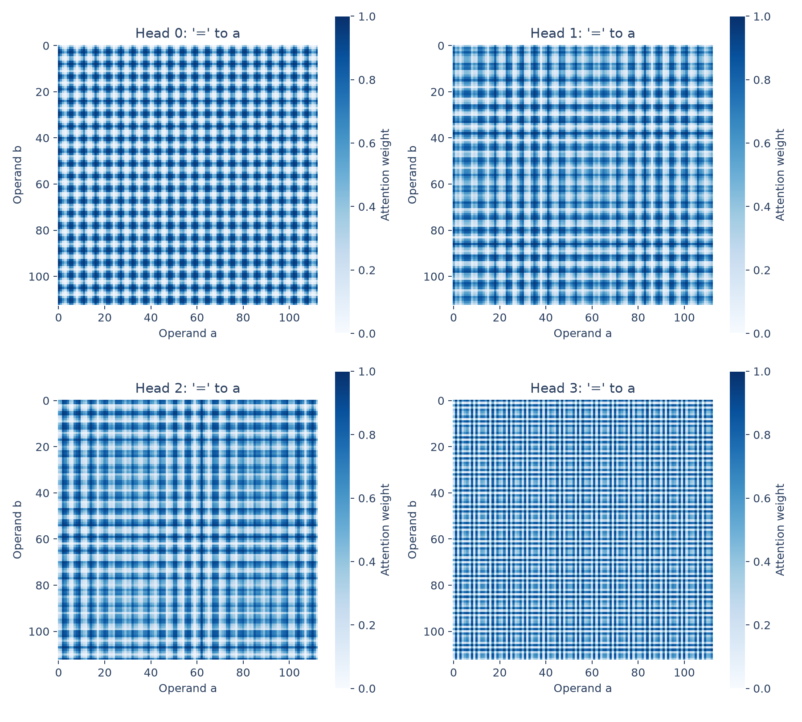
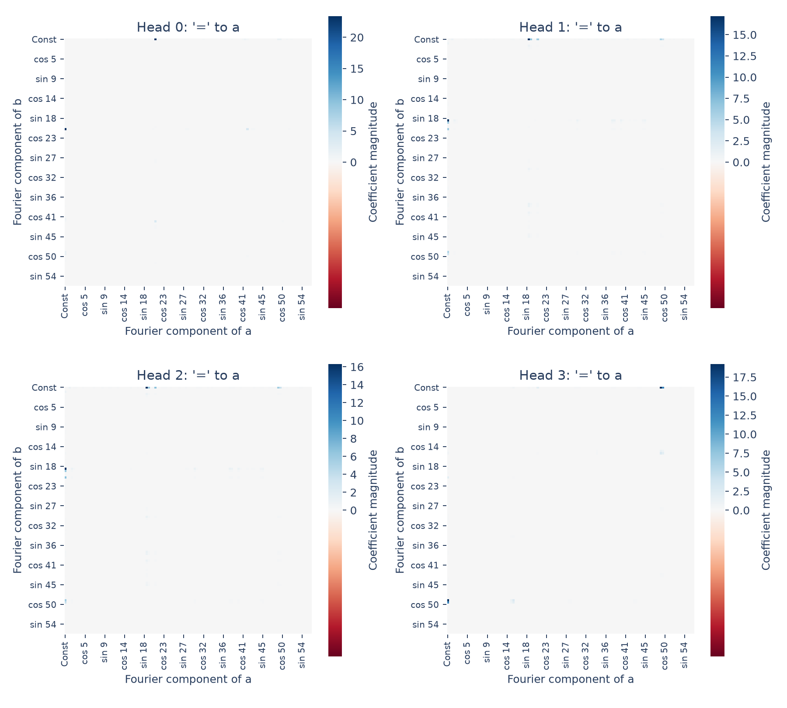

# Periodicity in attention

Attention from `=` to the first operand shows strong frequency structure.
Head 0 is dominated by frequency **21**; the other heads are dominated by
**19, 19, and 49**.

## Method

For each pair $(a,b)$, run the original model on `[a, b, =]`. Capture the
query and key projections and reconstruct the final-position attention weights:

$$
A_h(a,b)=
\frac{\exp(q_{h,=}^\top k_{h,a}/\sqrt{32})}
{\sum_{t\in\{a,b,=\}}\exp(q_{h,=}^\top k_{h,t}/\sqrt{32})}.
$$

This is the softmax attention weight, not the pre-softmax score or the head's
output vector. The `=` key remains in the denominator. All four heads are shown;
head 0 matches the example component examined in Section 4.1 of the paper.



To quantify the patterns, transform both operand axes using the real orthonormal
Fourier basis $B$, ordered as constant, cosine 1, sine 1, cosine 2, sine 2, etc.:

$$
F_h=B^\top A_hB.
$$



The spectrum plots show coefficient magnitudes. The input-independent mean
is hidden for readability; saved coefficients retain it. Each positive
frequency occupies two adjacent cells, one for cosine and one for sine.

## Findings

| Head | Dominant frequency | Variation involving that frequency |
|---:|---:|---:|
| 0 | 21 | 98.69% |
| 1 | 19 | 80.99% |
| 2 | 19 | 76.59% |
| 3 | 49 | 99.09% |

For each frequency, the percentage sums squared coefficients in cells where
either operand has that frequency, counting the intersection once. It is
normalized by total squared coefficients after excluding the mean. Shares
for different frequencies can overlap; they are not a partition of energy.

The dominant frequencies also occur among the embedding peaks. This connects
the observed attention patterns to the residue Fourier basis, but does not
show that attention computes the sum or that these heads are causally necessary.

## Reproduce

```bash
python 4.1-periodicity/attention/analyze.py
```

[analyze.py](analyze.py) saves the two plots, [summary.csv](summary.csv), and
[attention.npz](attention.npz), containing maps `[a,b,head]` and signed Fourier
coefficients in the same axis order. See the [section overview](../README.md)
for full-grid scope, provenance, and checks.
