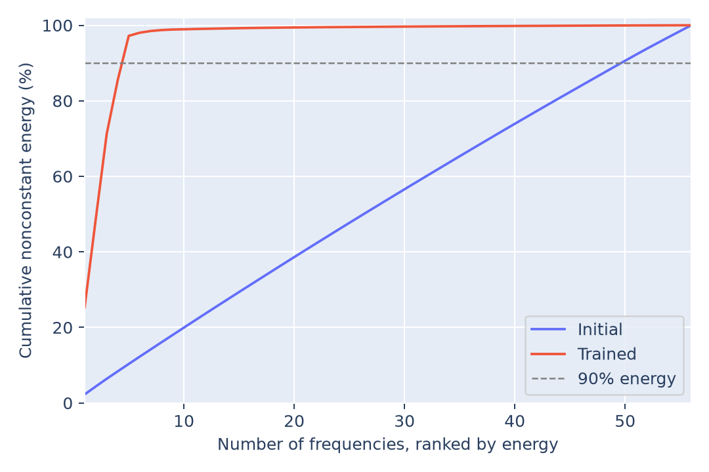

# Periodicity in the embeddings

The trained embeddings concentrate **97.19% of their nonconstant Fourier
energy in five frequencies: 19, 20, 21, 31, and 49**. The initial embeddings
have a much flatter spectrum.

This analysis follows [Section 4.1 of Nanda et al., *Progress measures for
grokking via mechanistic interpretability*](https://arxiv.org/html/2301.05217v3#S4.SS1).
It compares the saved initialization with the selected checkpoint at update
39,800 (model seed 999, data seed 0).

## Method

Let $E\in\mathbb R^{113\times128}$ be the number-token embedding table.
Each row corresponds to a residue $a$; each column is an embedding coordinate.
The `=` token and positional embeddings are excluded.

Project the residue axis onto real orthonormal cosine and sine vectors:

$$
b_{k,c}(a)=\sqrt{\frac{2}{113}}\cos\left(\frac{2\pi ka}{113}\right),\qquad
b_{k,s}(a)=\sqrt{\frac{2}{113}}\sin\left(\frac{2\pi ka}{113}\right).
$$

For $k=1,\ldots,56$, compute separate component norms over embedding coordinates:

$$
n_{k,c}=\|b_{k,c}^{\top}E\|_2,\qquad
n_{k,s}=\|b_{k,s}^{\top}E\|_2,\qquad
e_k=n_{k,c}^2+n_{k,s}^2.
$$

Blue bars show sine norms; red-orange bars show cosine norms, as in Figure 3.
The basis normalization gives

$$
\sum_{k=1}^{56}e_k=\sum_a\|E_a-\overline E\|_2^2,\qquad
\overline E=\frac{1}{113}\sum_a E_a.
$$

Each reported energy share is $e_k/\sum_{\ell=1}^{56}e_\ell$. Separating sine and
cosine changes the displayed norms, but preserves the combined energy fractions
of the previous complex-FFT calculation.

## Results


| Frequency | Share of trained energy at nonzero frequencies |
|---:|---:|
| 19 | 22.70% |
| 20 | 14.28% |
| 21 | 23.20% |
| 31 | 11.73% |
| 49 | 25.29% |

The five largest frequencies explain **10.33%** of energy at nonzero frequencies initially
and **97.19%** after training. Reaching 90% requires **50 frequencies initially**
and **five after training**.

The norm panels use separate vertical scales because total embedding energy
falls from 14,660.49 to 157.62. The cumulative plot compares normalized energy:



Training produced embeddings dominated by a few sinusoidal components over
residue identity. Smaller components remain, so the spectrum is approximately
sparse. This supports the paper's embedding-periodicity observation, but does
not establish that these frequencies are used to compute addition. That needs
readout analysis, activation analysis, and interventions.

## Reproduce

From the repository root, with the existing requirements installed:

```bash
python 4.1-periodicity/embeddings/analyze.py
```

[analyze.py](analyze.py) reads the public [initial](../../results/initial.pt) and
[selected](../../results/selected.pt) weights and verifies their hashes against
the [manifest](../../results/manifest.json). It saves the two plots above and
[spectrum.csv](spectrum.csv), containing separate sine/cosine norms and energy fractions for both
checkpoints.

Checks cover basis orthonormality, reconstruction, and energy conservation.
Combined frequency energies were independently checked against a complex FFT
and known-frequency signals. No training or final-split evaluation is performed.
