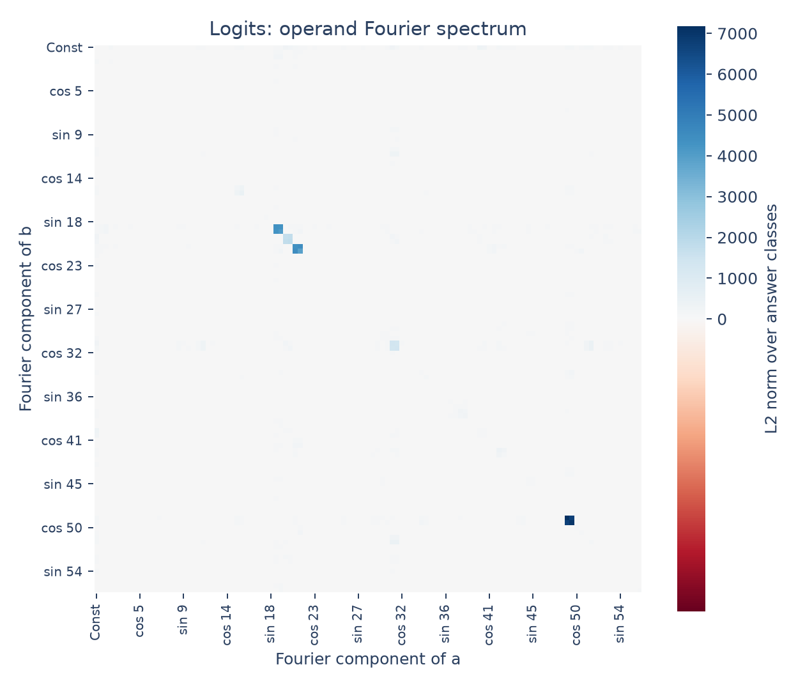
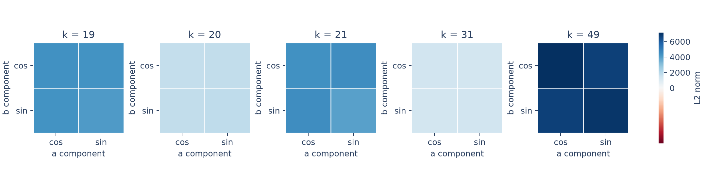
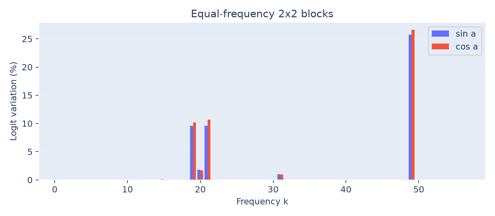

# Periodicity in logits

The operand Fourier spectrum of the model's answer scores is concentrated in
five equal-frequency blocks: **19, 20, 21, 31, and 49**. Together they account
for **97.73% of input-dependent logit energy**, matching the embedding peaks.

## Method

Collect raw logits for every ordered input pair:

$$
Z[a,b,c]\in\mathbb R^{113\times113\times113}.
$$

Transform only the operand axes, using the real orthonormal Fourier basis $B$:

$$
\widehat Z_{i,j,c}=\sum_{a,b}B_{a,i}Z_{a,b,c}B_{b,j},\qquad
N_{i,j}=\sqrt{\sum_c\widehat Z_{i,j,c}^2}.
$$

The answer axis $c$ is pooled by an L2 norm, not transformed. The heatmap follows
the paper's real-basis convention: each frequency has a cosine and sine cell.



The input-independent cell $(0,0)$ is hidden in the plot and excluded from
reported energy fractions. It remains in the saved norms. Raw logits are used;
answer-shared offsets are not subtracted.

## Findings

Each equal-frequency block contains four components: cosine/cosine,
cosine/sine, sine/cosine, and sine/sine. The five leading blocks contain the
**20 largest real Fourier cells**, which together explain **97.73%** of variation.



| Frequency | Share of input-dependent logit energy |
|---:|---:|
| 19 | 19.78% |
| 20 | 3.46% |
| 21 | 20.21% |
| 31 | 1.97% |
| 49 | 52.31% |



Blue and red-orange bars separate the sine and cosine components of operand
$a$, each summed over both sine/cosine components of $b$. Their sum gives the
block energy in the table. The full spectrum and enlarged blocks use the paper's
red-white-blue palette with zero at white; all displayed norms are nonnegative.

This is consistent with an output built from a few operand Fourier frequencies.
However, these blocks can represent both sum-dependent and difference-dependent
functions, and pooling norms removes sign and phase information. Their presence
does not establish the proposed sum computation. Readout composition, signed
activation fits, and causal interventions remain to be tested.

## Reproduce

```bash
python 4.1-periodicity/logits/analyze.py
```

[analyze.py](analyze.py) saves the three plots, [frequency-energy.csv](frequency-energy.csv),
and [fourier-norms.npz](fourier-norms.npz), containing the full $113\times113$
norm matrix. See the [section overview](../README.md) for full-grid scope and checks.
