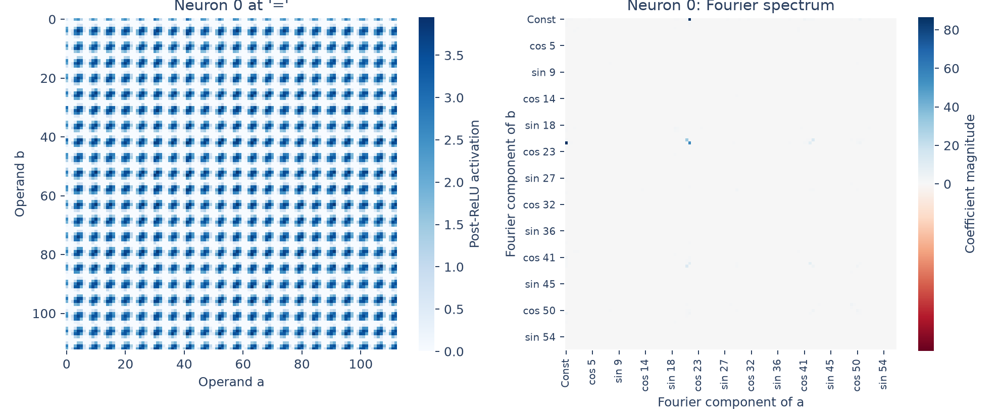

# Periodicity in an MLP neuron

Neuron 0's activation has strong periodic structure. Terms involving frequency
**21** account for **98.27% of its variation across operand pairs**.

## Method

Run the original model on every `[a, b, =]` input and capture the output of its
ReLU at the final position. For neuron 0, this is

$$
H(a,b)=\left[\operatorname{ReLU}(W_{\mathrm{in}}x_1(a,b))\right]_0,
$$

where $x_1$ is the residual state immediately before the MLP. Neuron 0 is fixed
in advance, matching the example index in Section 4.1; it is not selected for
having a visually interesting pattern.

Transform the two operand axes using the real orthonormal Fourier basis:

$$
F=B^\top HB.
$$



The left panel shows post-ReLU activations. The right shows coefficient
magnitudes, with the input-independent mean hidden. Each positive frequency
has adjacent cosine and sine cells. Signed coefficients are retained in the
saved numerical output.

## Findings

Frequency 21 dominates the variation and also appears in the embeddings and
head 0's attention pattern. The 98.27% figure sums energy in Fourier cells
where either operand has frequency 21, counting their intersection once,
and divides by total energy after removing the mean.

This measures periodicity, not agreement with a function of $a+b$. Additive
operand terms and interaction terms both contribute. Determining whether the
neuron helps form sum features requires later activation fits and interventions.
This example does not characterize all 512 neurons.

## Reproduce

```bash
python 4.1-periodicity/neurons/analyze.py
```

[analyze.py](analyze.py) saves the plot, [frequency-energy.csv](frequency-energy.csv),
and [neuron-0.npz](neuron-0.npz), containing the activation map and signed Fourier
coefficients, both indexed `[a,b]` or their corresponding basis coordinates.
See the [section overview](../README.md) for full-grid scope and checks.
