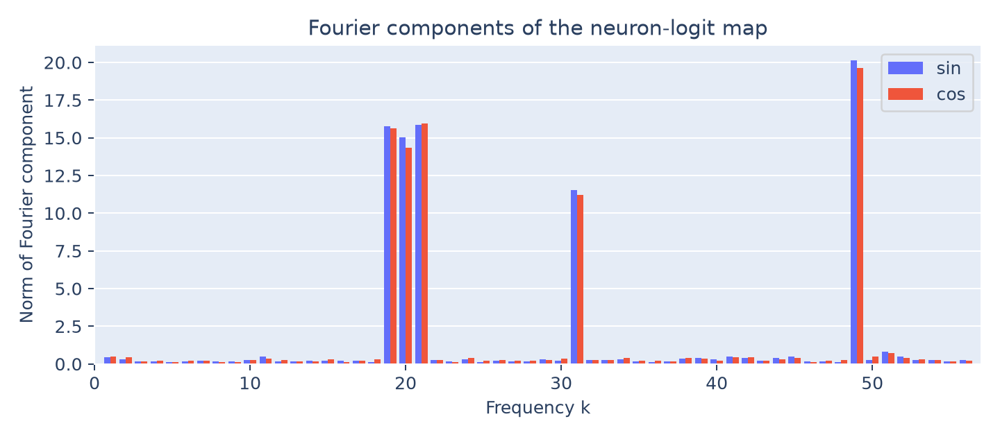

# Periodicity in the neuron-logit map

The same five frequencies found in the embeddings dominate the effective MLP
readout: **19, 20, 21, 31, and 49**. Together they contain **99.64% of its
nonconstant Fourier energy**.

This is the companion weight spectrum in Figure 3 (right) of the paper.
It does not implement Section 4.2's activation-composition tests.

## Method

Compose the trained unembedding and MLP output matrices:

$$
G=UW_{\mathrm{out}}\in\mathbb R^{113\times512}.
$$

This maps post-ReLU MLP activations to their contribution to answer logits.
The model also has a residual contribution, which is not included in $G$.

Transform the answer-residue rows into the real orthonormal Fourier basis:

$$
F=B^\top G,\qquad n_i=\sqrt{\sum_{j=0}^{511}F_{i,j}^2}.
$$



Blue bars show sine norms; red-orange bars show cosine norms. Squaring and
adding the two norms gives each frequency's energy. The reported percentage
is normalized over nonzero frequencies.

The agreement with the embedding peaks supports a shared Fourier structure
across input and output weights. Whether the activations between them encode
the sum remains to be tested.

## Reproduce

```bash
python 4.1-periodicity/readout/analyze.py
```

[analyze.py](analyze.py) saves the plot and [spectrum.csv](spectrum.csv), with
separate sine/cosine norms and energies. It uses only the saved weights.
See the [section overview](../README.md) for provenance and checks.
