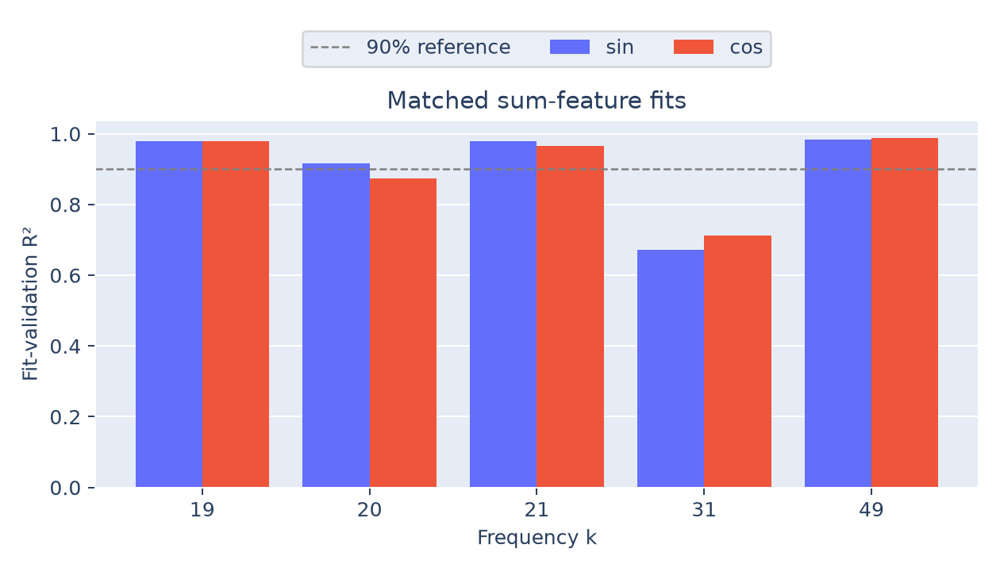
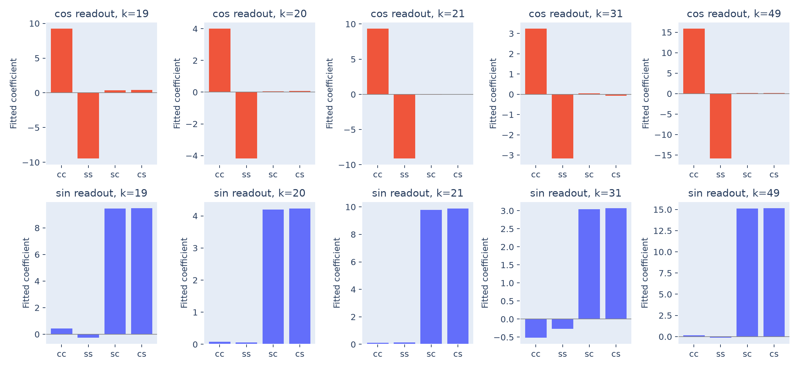

# Output-linked activation signals

The readout directions extract sum-dependent signals from the MLP activations.
The match is strong for frequencies **19, 21, and 49**, mixed for **20**, and
weaker for **31**. Seven of ten matched fits exceed 90% fit-validation R².

## Method

At the answer position, capture the 512 post-ReLU activations $h(a,b)$. For
$\omega_k=2\pi k/113$, define the hidden directions fixed by the output weights:

$$
u_k=\frac{2}{113}G^\top[\cos(\omega_k c)]_c,\qquad
v_k=\frac{2}{113}G^\top[\sin(\omega_k c)]_c.
$$

These use the paper's unnormalized sine/cosine convention, so

$$
G_K=\sum_{k\in K}\cos(\omega_k c)u_k^\top+
\sin(\omega_k c)v_k^\top.
$$

The measured signals are $q_{k,c}=u_k^\top h$ and $q_{k,s}=v_k^\top h$.
Fit one gain per signal, without an intercept:

$$
q_{k,c}(a,b)\approx\alpha_{k,c}\cos(\omega_k(a+b)),\qquad
q_{k,s}(a,b)\approx\alpha_{k,s}\sin(\omega_k(a+b)).
$$

Coefficients use 2,234 discovery pairs; scores below use the other 2,235
development pairs. We use $R^2=1-\sum(q-\widehat q)^2/\sum(q-\overline q)^2$,
with the evaluation subset's mean in the denominator.

## Findings

| Frequency | Cosine gain | Cosine R² | Sine gain | Sine R² |
|---:|---:|---:|---:|---:|
| 19 | 9.3285 | 0.9788 | 9.4714 | 0.9790 |
| 20 | 4.0901 | 0.8745 | 4.2160 | 0.9153 |
| 21 | 9.2124 | 0.9654 | 9.8365 | 0.9785 |
| 31 | 3.2035 | 0.7124 | 3.0683 | 0.6723 |
| 49 | 15.8456 | 0.9883 | 15.1398 | 0.9846 |



For a Table 1 analogue, independently fit the four products
$[c_ac_b,s_as_b,s_ac_b,c_as_b]$, where $c_a=\cos(\omega_k a)$ and similarly
for the other terms. The expected patterns are opposite coefficients on
$c_ac_b,s_as_b$ for cosine of the sum, and equal coefficients on
$s_ac_b,c_as_b$ for sine of the sum. The fitted signs and magnitudes broadly
follow those patterns; all four coefficients are retained in the CSV.



The directions are fixed by learned output weights, rather than chosen by a free
probe. Their sum dependence therefore connects the activations to the readout.
The paper's uniformly strong matched fits are not reproduced: cosine at 20 and
both signals at 31 fall below 90%. This is a partial, frequency-dependent match,
and it does not establish causal necessity.

## Plots and reproduction

Observed/fitted maps and fit-validation scatters are saved for every frequency:
[19](frequency-19.png), [20](frequency-20.png), [21](frequency-21.png),
[31](frequency-31.png), and [49](frequency-49.png). These full-grid maps are
descriptive; the scatter scores use only fit-validation pairs.

```bash
python 4.2-weights/activations/analyze.py
```

[analyze.py](analyze.py) saves the plots, [fits.csv](fits.csv), and
[signals.npz](signals.npz). The array file retains observed signals, gains,
product coefficients, frequencies, and the exact fitting/validation IDs.
See the [section overview](../README.md) for the shared scope and limitations.
