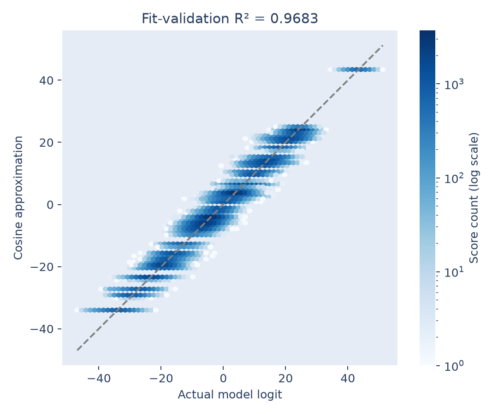
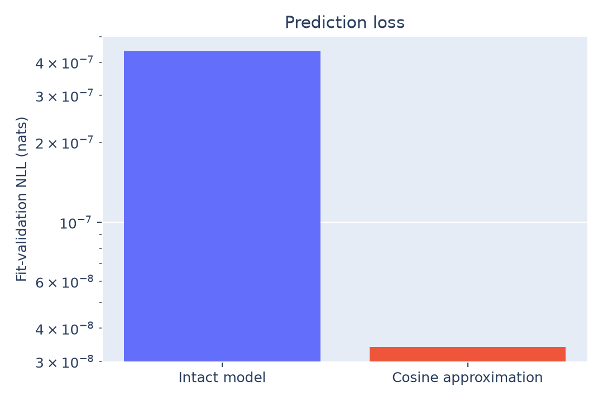

# Approximating the logits

Five fitted cosine terms explain **96.83% of fit-validation logit variance**.
The approximation preserves **2,235/2,235** fit-validation answers and has lower
prediction loss than the intact model on those pairs.

## Method

First check the exact bias-free decomposition at the answer position:

$$
z(a,b)=Ux_1(a,b)+Gh(a,b).
$$

Captured activations come from the original float32 forward pass. Reconstructing
the expression in float64 gives maximum absolute error **3.41e-5** and relative
Frobenius error **1.76e-7**, consistent with float32 rounding.

Then fit the score family from Section 4.2:

$$
\widehat z_c(a,b)=\sum_{k\in K}\lambda_k
\cos\left(\frac{2\pi k(a+b-c)}{113}\right).
$$

Zero-intercept least squares uses all 113 answer scores on each of the 2,234
discovery pairs. The other 2,235 development pairs assess the frozen coefficients.
Raw logits are fitted; the CSV also reports fidelity after subtracting each
input's mean score across answers, which leaves softmax probabilities unchanged.

## Findings

| Frequency | Fitted coefficient |
|---:|---:|
| 19 | 9.9514 |
| 20 | 4.1427 |
| 21 | 10.0252 |
| 31 | 3.1241 |
| 49 | 16.2025 |



| Score function | Fit-validation accuracy | Mean NLL |
|---|---:|---:|
| Intact model | 100% | 4.40224e-7 |
| MLP contribution alone | 100% | 1.35969e-6 |
| Residual contribution alone | 15.70% | 3.81249 |
| Selected readout plus original residual | 100% | 5.82805e-7 |
| Five-frequency cosine approximation | 100% | 3.39770e-8 |

The approximation's raw-logit R² is **0.96831** on fit-validation pairs and
**0.96905** on the full grid. The latter is a descriptive diagnostic.



The residual route matters to loss even though the MLP alone preserves accuracy.
It is therefore measured explicitly instead of silently omitted.

The cosine family already encodes modular addition: with positive coefficients
and nonzero frequencies modulo a prime, the correct answer uniquely maximizes
the score. Its perfect accuracy alone is therefore insufficient evidence about
the network. The informative result is that this compact function also closely
matches the network's logits. Lower loss is a property of the fitted score
approximation; no weights were retrained, and no causal intervention was run.

## Reproduce and outputs

```bash
python 4.2-weights/logits/analyze.py
```

[analyze.py](analyze.py) saves the plots, [coefficients.csv](coefficients.csv),
[metrics.csv](metrics.csv), [metrics.json](metrics.json), and [fit.npz](fit.npz).
The CSV contains train, discovery, fit-validation, and combined-development
results, including reconstruction and centred-score checks. No final-split
accuracy or loss is calculated. Coefficients and exact fitting IDs are saved
so the approximation can be reconstructed without saving a redundant logit grid.
