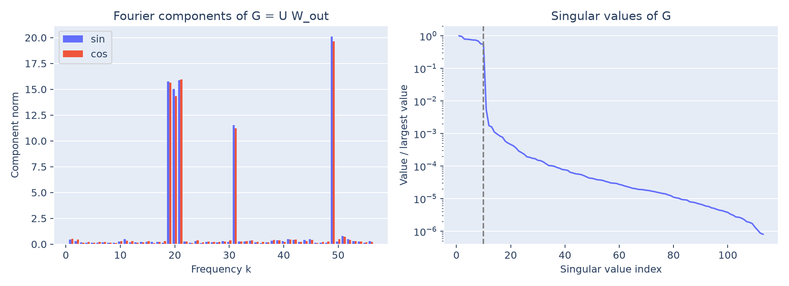
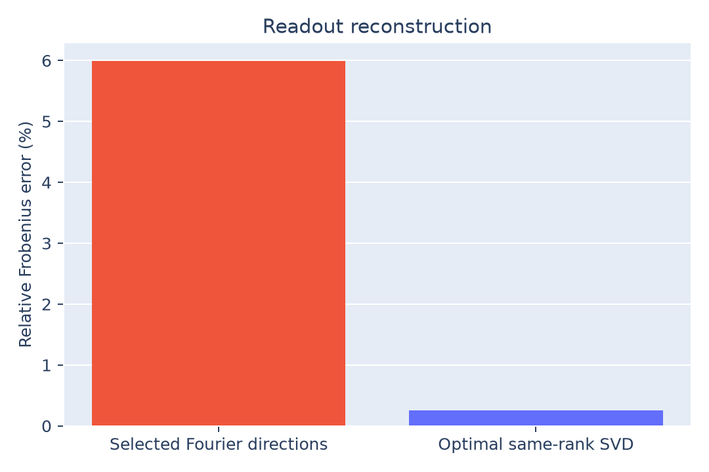

# Readout composition

The effective MLP readout is almost rank 10. Its leading ten singular directions
retain **99.9993% of squared matrix norm**. The ten selected Fourier directions
are a less accurate approximation, with **5.99% relative Frobenius error**.

## Method

Compose the trained weights:

$$
G=UW_{\mathrm{out}}\in\mathbb R^{113\times512}.
$$

Using the real orthonormal residue basis $B$, select frequency pairs from the
row energies of $B^\top G$. The local 90%-coverage rule selects
$K=\{19,20,21,31,49\}$. If $B_K$ contains their ten sine/cosine vectors, then

$$
G_K=B_KB_K^\top G.
$$

This is the projection onto the selected output-frequency subspace. Compare it
with the best rank-10 approximation from the SVD, $G=L\Sigma V^\top$:

$$
G_{10}=L_{:10}\Sigma_{:10,:10}V_{:10}^{\top},\qquad
\varepsilon(A)=\frac{\|G-A\|_F}{\|G\|_F}.
$$



## Findings

| Measurement | Value |
|---|---:|
| Nonconstant Fourier energy in the selected frequencies | 99.6413% |
| Relative error of $G_K$ | 5.9900% |
| Relative error of the optimal rank-10 SVD | 0.2589% |
| Squared norm retained by rank-10 SVD | 99.9993% |
| Numerical rank at the recorded float64 tolerance | 113 |



The sharp singular-value drop supports an approximately ten-dimensional readout.
Its numerical rank is still 113: small singular values are present. Energy
retention is a squared-norm quantity; 99.64% energy retention is compatible with
about 6% norm error.

The paper reports a much smaller Fourier reconstruction error for its reference
run. Our checkpoint supports the low-rank structure, but its ten-dimensional
Fourier subspace is a weaker approximation. These measurements concern weights,
not whether the intervening activations compute the sum.

## Reproduce and outputs

```bash
python 4.2-weights/readout/analyze.py
```

[analyze.py](analyze.py) saves the two plots, [metrics.json](metrics.json),
[spectrum.csv](spectrum.csv), [singular-values.csv](singular-values.csv), and
[readout.npz](readout.npz). The array file contains $G$, $G_K$, selected hidden
readout directions, singular values, and frequency IDs. Selection provenance
is in [frequencies.json](../frequencies.json).
