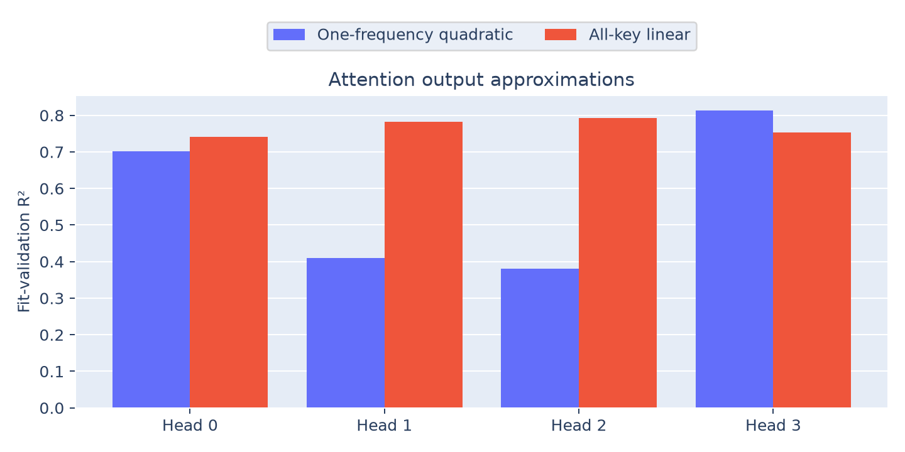
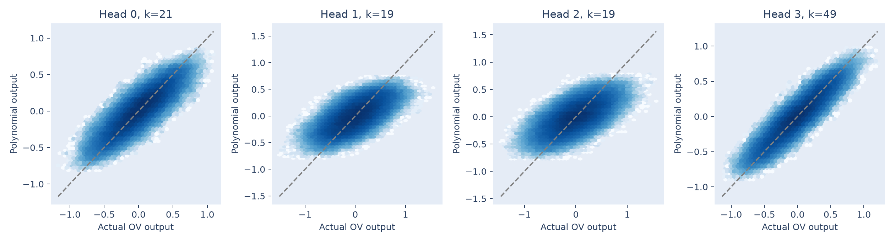
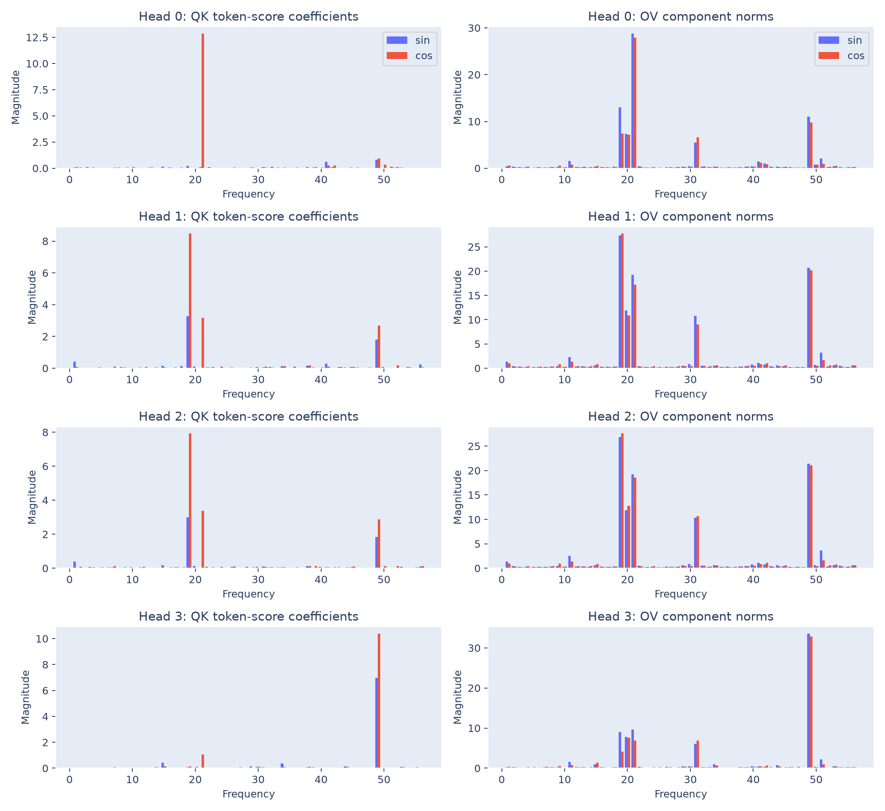

# Attention-head approximations

Attention patterns show clear frequency structure, but this checkpoint's head
outputs mix frequencies. The single-frequency quadratic account is strongest
for head 3 and weaker for the other heads.

## Method

For each head, capture its contribution at the answer position **after its
own output projection**, before head contributions are summed:

$$
o_j(a,b)=W_O^{(j)}\sum_{t\in\{a,b,=\}}A^{(j)}_{=,t}W_V^{(j)}x_t.
$$

Learned positions and attention to `=` remain in the forward computation.
Fit $o_j$ with the same 13-term [quadratic basis](../neurons/README.md#method)
used for neurons. Choose one frequency for the **whole head**, using discovery
squared error pooled over its 128 output coordinates. Compare with a linear
model containing a constant and sine/cosine functions of both operands at all
five key frequencies: **21 features**. These are different function families
with different parameter counts, rather than a controlled model-size comparison.

All coefficients and frequency choices use the 2,234 discovery pairs. Scores
below use the 2,235 fit-validation pairs. For vector outputs, use

$$
R^2=1-\frac{\sum_i\|o_i-\widehat o_i\|^2}
{\sum_i\|o_i-\overline o\|^2},
$$

centring each output coordinate separately on the evaluation subset.

## Findings

| Head | Quadratic frequency | One-frequency quadratic R² | All-key linear R² |
|---:|---:|---:|---:|
| 0 | 21 | 0.7011 | 0.7420 |
| 1 | 19 | 0.4107 | 0.7827 |
| 2 | 19 | 0.3802 | 0.7928 |
| 3 | 49 | 0.8141 | 0.7535 |





Heads 1 and 2 are better described by the all-key linear family, whereas
head 3 favours its single-frequency quadratic. None of the quadratic head
fits exceed 85%. The clean head roles discussed in the reference's
[Appendix C.1.2](https://arxiv.org/html/2301.05217v3#A3.SS1.SSS2) are not fully
reproduced by these measurements.

## Attention patterns and weight composition

Also fit the reference's pattern family, independently choosing its frequency:

$$
A^{(j)}_{=,a}\approx\frac12+
\alpha_j[\cos(\omega_k a)-\cos(\omega_k b)]+
\beta_j[\sin(\omega_k a)-\sin(\omega_k b)].
$$

The intercept is fixed at $1/2$; predictions are not clipped. The actual pattern
uses a softmax over **all three keys**, including `=`.

| Head | Pattern frequency | Pattern R² | OV energy at pattern frequency | OV energy at all key frequencies |
|---:|---:|---:|---:|---:|
| 0 | 21 | 0.9577 | 71.46% | 99.03% |
| 1 | 19 | 0.7951 | 43.16% | 98.79% |
| 2 | 19 | 0.7512 | 40.43% | 98.71% |
| 3 | 49 | 0.9650 | 82.57% | 99.20% |

The weight spectra come from the token-dependent QK score table
$C_j[a]=(W_K^{(j)}E_a)^\top W_Q^{(j)}x_{=}/\sqrt{32}$ and the OV map
$V_j[a]=W_O^{(j)}W_V^{(j)}E_a$. Positional offsets contribute constants here;
only the nonconstant spectra are plotted. Sine and cosine magnitudes remain
separate, using the existing blue/red-orange convention.



Mean self-attention ranges from 0.16% to 0.23%, but it is retained throughout.
Heads 1 and 2 have opposite pattern coefficients at frequency 19. Their
attention-to-$a$ weights sum to one with RMS error **0.2377** over the full grid;
their nonconstant OV maps have cosine similarity **0.5678**. They therefore do
not closely satisfy both ingredients of the reference's embedding-amplification
account. The linear fits alone cannot establish that role.

## Reproduce and outputs

```bash
python 4.3-neurons/attention/analyze.py
```

[analyze.py](analyze.py) saves [fits.csv](fits.csv), all six head-pair comparisons
in [pairs.csv](pairs.csv), [metrics.json](metrics.json), and [fits.npz](fits.npz).
The array file retains polynomial/linear/pattern coefficients, chosen head
frequency indices, signed QK/OV Fourier coefficients, and exact fitting IDs.
Pattern frequencies are recorded in the CSV. The full-grid spectra and pair
comparisons are descriptive; no intervention or final accuracy/loss is evaluated.
