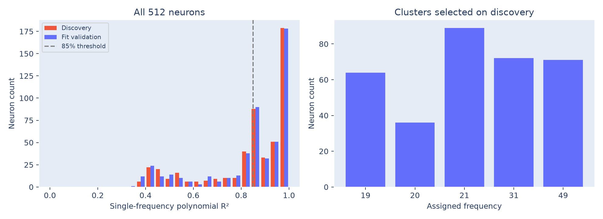
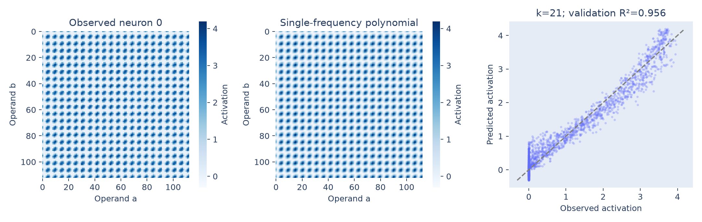
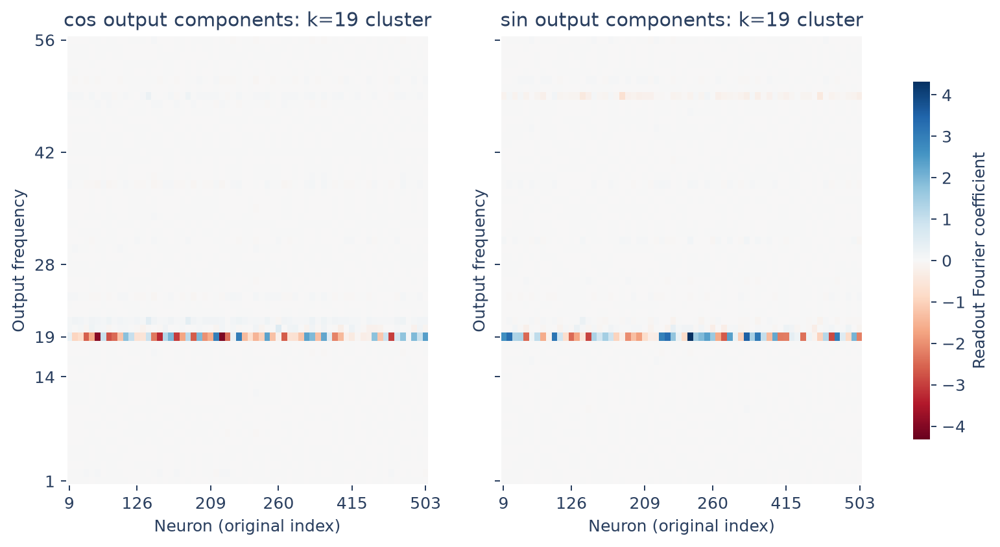

# Single-frequency neuron fits

Many MLP neurons are well approximated by a quadratic polynomial of sine and
cosine features at one frequency. Their readout weights are strongly localized
at that same frequency.

## Method

Capture all **512 post-ReLU activations** at the answer position. For each
$k\in\{19,20,21,31,49\}$, fit each neuron's activation using the feature vector

$$
\phi_k(a,b)=\left[1,c_a,s_a,c_b,s_b,
\cos(2\omega_k a),\sin(2\omega_k a),
\cos(2\omega_k b),\sin(2\omega_k b),
c_ac_b,s_as_b,s_ac_b,c_as_b\right],
$$

where $\omega_k=2\pi k/113$, $c_a=\cos(\omega_k a)$, and similarly for the other
terms. These **13 independent terms** span every polynomial of degree at most
two in $c_a,s_a,c_b,s_b$. The usual 15 monomials contain two redundancies because
$c_a^2+s_a^2=c_b^2+s_b^2=1$.

Ordinary least squares fits $h_j(a,b)\approx\phi_k(a,b)^\top\beta_{k,j}$ on the
2,234 discovery pairs. Each neuron chooses the frequency with the highest
**discovery** $R^2$. The frozen frequency and coefficients are then assessed
on 2,235 fit-validation pairs. Neither frequency selection nor the cluster
threshold uses fit-validation scores.

## Findings

| Measurement | Neurons |
|---|---:|
| Discovery R² > 0.85; used to define clusters | 332 / 512 (64.84%) |
| Fit-validation R² > 0.85, across all frozen fits | 307 / 512 (59.96%) |
| Above 0.85 on both discovery and fit validation | 299 / 512 (58.40%) |



The reference reports 433/512 neurons above its 85% criterion. Our count is
lower; the checkpoint and discovery/validation fitting protocol also differ.
The threshold selects a useful subset here rather than establishing that every
neuron has a single-frequency description.

Neuron 0, fixed before analysis, selects $k=21$ and reaches fit-validation
$R^2=0.9561$. Its fitted polynomial is shown without clipping negative predictions.



## Readout localization

Transform $G=UW_{\mathrm{out}}$ along the answer axis, $\widetilde G=B^\top G$.
For each selected neuron, compare its assigned input frequency with the output
frequency maximizing $\widetilde G_{2k-1,j}^2+\widetilde G_{2k,j}^2$.
The table pools this paired energy over each cluster, excluding the constant
component from the denominator.

| Assigned frequency | Selected neurons | Strongest output frequency matches | Output energy at assigned frequency |
|---:|---:|---:|---:|
| 19 | 64 | 64 / 64 | 98.45% |
| 20 | 36 | 36 / 36 | 99.21% |
| 21 | 89 | 89 / 89 | 98.13% |
| 31 | 72 | 72 / 72 | 98.11% |
| 49 | 71 | 71 / 71 | 99.29% |



Separate cosine/sine heatmaps are saved for every cluster:
[19](readout-frequency-19.png), [20](readout-frequency-20.png),
[21](readout-frequency-21.png), [31](readout-frequency-31.png),
[49](readout-frequency-49.png). Each column retains its original neuron index.

This links input-frequency tuning to output-frequency weights. A general
quadratic also includes operand-only and difference features; a good fit here
does not imply a pure sine or cosine of the sum. That stricter correspondence
was tested in [Section 4.2](../../4.2-weights/activations/README.md).
No causal necessity or sufficiency is established here.

## Reproduce and outputs

```bash
python 4.3-neurons/neurons/analyze.py
```

[analyze.py](analyze.py) saves [fits.csv](fits.csv) for every neuron,
[clusters.csv](clusters.csv), [metrics.json](metrics.json), and [fits.npz](fits.npz).
The array file contains the selected coefficients, all candidate-frequency
fit scores, assigned frequencies, discovery-selected mask, feature names,
and exact discovery/validation IDs. See the [section overview](../README.md)
for the shared evaluation limitations.
