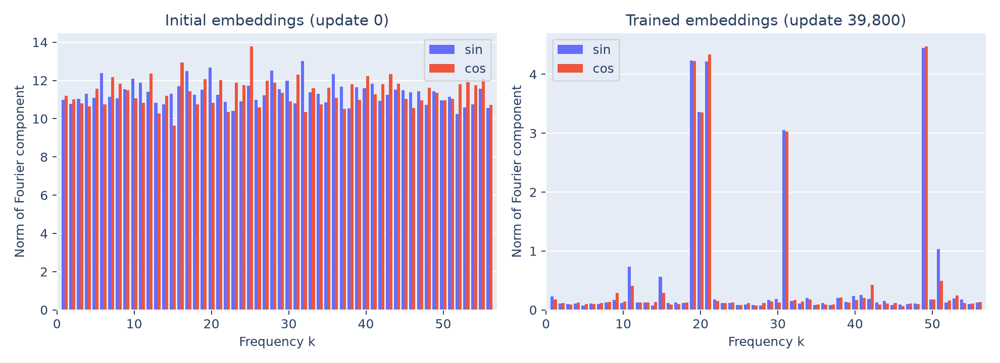

# Grokking and Mechanistic Interpretability

## Aim

Study grokking in a small modular-addition transformer and test the Fourier
computation proposed in [*Progress Measures for Grokking via Mechanistic
Interpretability*](https://arxiv.org/html/2301.05217v3).

## Current progress

The trained model exhibits grokking: it fits training examples early and
generalizes to unseen pairs much later. See the [grokking findings](docs/grokking.md).

The [Section 4.1 analyses](4.1-periodicity/README.md) are complete, showing Fourier
structure in the embeddings, readout, attention, neuron 0, and logits.

The addition mechanism remains unverified. [Saved evidence and verification](results/README.md)
are available. The checkpoint was selected by minimum validation loss; full-grid
diagnostics include final inputs, but final accuracy and loss remain unreported.

## Remaining work

Test readout composition and sum-dependent activation signals, validate their
role through controlled interventions, and report final-split results. Repeat
across training seeds to assess robustness.
