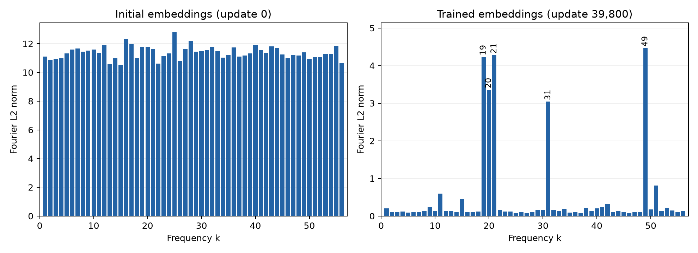

# Grokking and Mechanistic Interpretability

## Aim

Study how a small transformer learns modular addition and whether it implements
the Fourier computation described in [*Progress Measures for Grokking via
Mechanistic Interpretability*](https://arxiv.org/html/2301.05217v3).

## Current progress

A model has been trained that exhibits grokking: it fits the training examples
early, then generalizes to unseen pairs much later.

Analysis of its embeddings shows that training concentrates their Fourier
structure into a few frequencies.

The model's internal addition mechanism remains unverified.

See the [grokking findings](docs/grokking.md) and
[embedding analysis](embeddings/README.md) for the methods, plots, and results.
The [saved evidence and verification instructions](results/README.md) support
reproducing the training results.

The checkpoint was selected by minimum validation loss over the training run.
The final test split remains reserved until the analysis choices are fixed.

## Remaining work

Analyze the readout and activations to test how the model combines operand
representations, then use controlled interventions to test their contribution
to predictions. Complete the reserved final evaluation and repeat the study
across additional training seeds.
