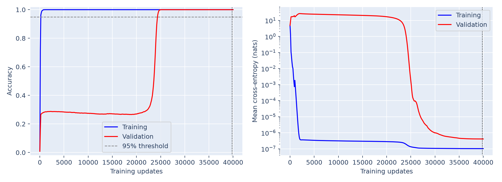

# Findings: grokking in a modular-addition transformer

**Experiment date:** 12 October 2026

**Run:** model seed 999, data seed 0, 40,000 full-batch updates

## Main result

This run exhibits **behavioral grokking** on addition modulo 113. Training
accuracy first reaches 100% at logged update **1,100** and remains perfect at
all later logged evaluations. Development accuracy stays low for many more
updates before reaching 100% at **25,100**—a separation of **24,000 updates**.

The selected model reaches **100% development accuracy (4,469/4,469)** with
mean negative log-likelihood (NLL) **4.10e-7 nats**. Additional checkpoint
evaluation recorded perfect accuracy on **3,123 development pairs for which
neither operand order occurred in training**. These observations establish
delayed generalization in this run; the internal computation remains unverified.

## Project and implementation

The project adapts the modular-addition experiment in Nanda et al.,
[*Progress measures for grokking via mechanistic interpretability*](https://arxiv.org/html/2301.05217v3#S3).
The task is to predict

$$
c=(a+b)\bmod 113
$$

from `[a, b, 113]`, where token 113 denotes `=`. The answer is a separate
label, never an input token. This is a finite synthetic arithmetic task.

The public implementation consists of three scripts:

- [model.py](../model.py): the transformer and its explicit forward computation.
- [data.py](../data.py): exhaustive ordered pairs and the seeded split.
- [train.py](../train.py): full-batch optimization, evaluation, and checkpointing.

| Setting | Value |
|---|---|
| Transformer blocks / residual width | 1 / 128 |
| Attention heads / head width | 4 / 32 |
| MLP width / activation | 512 / ReLU |
| Position embeddings | Learned |
| Normalization, biases, dropout | None |
| Token embedding and readout | Untied |
| Output classes / parameters | 113 / 226,048 |
| Optimizer | AdamW |
| Learning rate / weight decay | 0.001 / 1.0 |
| Betas / epsilon | (0.9, 0.98) / 1e-8 |
| Batch / update budget | Full training split / 40,000 |
| Forward / loss dtype | float32 / float64 logits-to-cross-entropy |

This run deliberately disables **both MLP biases**. Appendix A of the
[reference paper](https://arxiv.org/html/2301.05217v3#A1) lists MLP bias vectors,
while its no-bias statement covers embedding, attention, and unembedding.
Accordingly, these results describe a **bias-free adaptation**; identical MLP
bias treatment in the original reference run is not asserted.

Both residual additions and self-attention at the `=` position are retained.
There is no learning-rate schedule or gradient clipping. Initialization uses
PyTorch embedding/linear defaults and positional normal standard deviation
0.02. The architecture and main budget follow the reference experiment, but
this is an adaptation rather than an identical initialized reference run.

## Dataset and shortcut controls

`modular_addition_split(p=113, seed=0)` in [data.py](../data.py) enumerates all
**12,769 ordered pairs** and partitions a NumPy-seeded permutation:

| Partition | Pairs | Purpose |
|---|---:|---|
| Training | 3,830 | Optimizer updates |
| Development | 4,469 | Trajectory evaluation and checkpoint selection |
| Final | 4,470 | Reserved for later evaluation |

Ordered pairs are unique and do not cross partitions. The labels are
`(a+b) % 113`; every input ends in `=`. Each residue appears in both operand
positions in training. The split and class counts can be reconstructed from
the public data function.

Because `(a,b)` and `(b,a)` can belong to different partitions, reverse-pair
memorization is a relevant control. The **reverse-pair lookup** predictor
returns the recorded training label for `(b,a)` when available, otherwise
predicting the training-majority answer, 40. Its development accuracy is
**30.54%**. The majority predictor alone scores **0.78%**. Uniform prediction
has expected accuracy **1/113 = 0.88%** and NLL **log(113) = 4.72739 nats**.
These baselines are reproducible from `data.py` with data seed 0.

## Evidence for grokking

Grokking is delayed generalization after the model has already fitted its
training examples, as studied by [Power et al.](https://arxiv.org/abs/2201.02177)
and the [modular-addition reference](https://arxiv.org/html/2301.05217v3#S3).
The published [metrics CSV](../results/metrics.csv) records 401 evaluations
at updates 0, 100, ..., 40,000.

| Update | Training accuracy | Development accuracy | Training NLL | Development NLL |
|---:|---:|---:|---:|---:|
| 200 | 96.21% | 26.81% | 0.111367 | 16.8148 |
| 1,100 | 100.00% | 28.49% | 0.000700063 | 17.3573 |
| 2,000 | 100.00% | 28.71% | 4.16255e-7 | 26.6933 |
| 10,000 | 100.00% | 27.50% | 3.11549e-7 | 22.4231 |
| 20,000 | 100.00% | 26.96% | 2.80558e-7 | 16.9758 |
| 23,000 | 100.00% | 35.18% | 2.51373e-7 | 8.68354 |
| 24,000 | 100.00% | 77.11% | 1.92602e-7 | 1.24973 |
| 24,400 | 100.00% | 96.24% | 1.59844e-7 | 0.128993 |
| 25,100 | 100.00% | 100.00% | 1.31460e-7 | 0.000934873 |
| 39,800 | 100.00% | 100.00% | 1.02543e-7 | 4.10273e-7 |

From updates 2,000 to 20,000, development accuracy ranges from **26.63% to
28.78%**, while training accuracy stays at 100%. At update 20,000, development
NLL is **16.98**, worse than uniform prediction, despite a training NLL of
approximately **2.81e-7**. This is a sustained generalization gap after the
training examples have been fitted.

Development accuracy then rises sharply around updates 23,000–25,100. It
first exceeds the 95% competence threshold at **24,400** and first reaches
100% at **25,100**. These are first observed crossings at a 100-update logging
cadence; exact between-evaluation crossing times were not measured.



*Figure 1.* Accuracy and mean NLL from the published CSV, without smoothing.
The horizontal dashed line marks the 95% competence threshold; the vertical
dotted line marks the selected update, 39,800. The NLL axis is logarithmic.

The early training fit, prolonged development gap, and later rise to perfect
development accuracy provide strong behavioral evidence of grokking in this
run. The early above-chance plateau does not by itself identify a computation:
the task admits shortcuts, and similarity to a baseline is not evidence that
the model implements that baseline.

## Selected-model results

Selection used the minimum development NLL among the 401 logged evaluations,
with the earliest checkpoint on an exact tie. The selected update is
**39,800**. The published log records 100% training and development accuracy,
training NLL **1.02543e-7**, and development NLL **4.10273e-7**.

Additional evaluation of that state recorded:

| Development subset | Correct / total | Accuracy | Reverse-pair lookup |
|---|---:|---:|---:|
| All development pairs | 4,469 / 4,469 | 100% | 30.54% |
| Reversed pair present in training | 1,346 / 1,346 | 100% | 100% |
| Neither operand order present in training | 3,123 / 3,123 | 100% | 0.61% |
| Diagonal (a=b) | 38 / 38 | 100% | 2.63% |

Perfect performance where neither order appeared in training rules out pure
reverse-pair lookup as a sufficient explanation of the recorded result. It
does not identify the learned algorithm.

The public evidence includes the [selected weights](../results/selected.pt),
[initial weights](../results/initial.pt), [exact split](../results/split.npz),
[per-example development predictions](../results/development_predictions.csv),
and a [configuration/checksum manifest](../results/manifest.json).
[verify.py](../verify.py) independently checks these files, reloads the model,
and recomputes development predictions and shortcut-stratified scores on CPU.
It audits the final partition without evaluating it.

```bash
python verify.py
```

See [the core evidence index](../results/README.md) for file formats and loading.
The published weight files contain only model tensors, so verification does
not require the full optimizer/checkpoint archive.

## Limitations and remaining work

- **One initialization:** the observation concerns seed 999; repeatability
  across seeds has not been established.
- **Development-based selection:** development examples do not enter optimizer
  updates, but their NLL selects the checkpoint. These scores are not an
  independent final-test estimate.
- **Final metrics deferred:** final accuracy, loss, and intervention metrics
  have not been reported. Full-grid [periodicity diagnostics](../4.1-periodicity/README.md)
  include the reserved final inputs; the partition is no longer untouched.
- **Mechanism untested:** Fourier structure has been characterized descriptively.
  Activation fits and causal interventions have not established Fourier
  multiplication in this model.
- **Cause of the transition unresolved:** this run does not isolate the effect
  of weight decay or other optimization choices.

The [Section 4.1 analyses](../4.1-periodicity/README.md) now characterize periodicity
in embeddings, the effective readout, attention patterns, neuron 0, and logits. The next analysis will
test readout composition and sum-dependent activation signals, followed
by controlled interventions.
The matrices are directly accessible in `model.py`:

```python
E = model.token_embedding.weight[:113]
U = model.unembed.weight
W_out = model.mlp_out.weight
G = U @ W_out
```

These are the parameters to analyze, not evidence of a mechanism by themselves.
The remaining work is to test the proposed computation, fix analysis choices
before final-set evaluation, and repeat the experiment across additional seeds.
